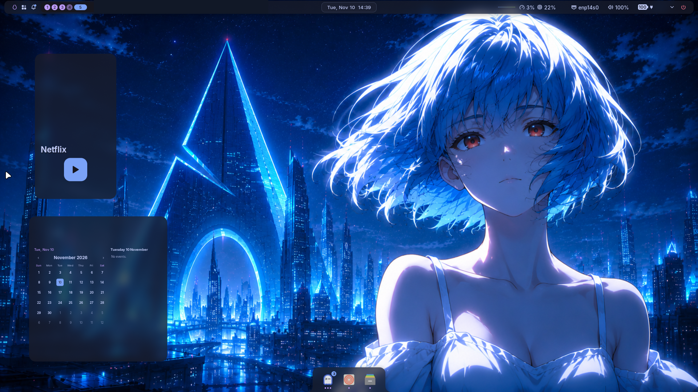
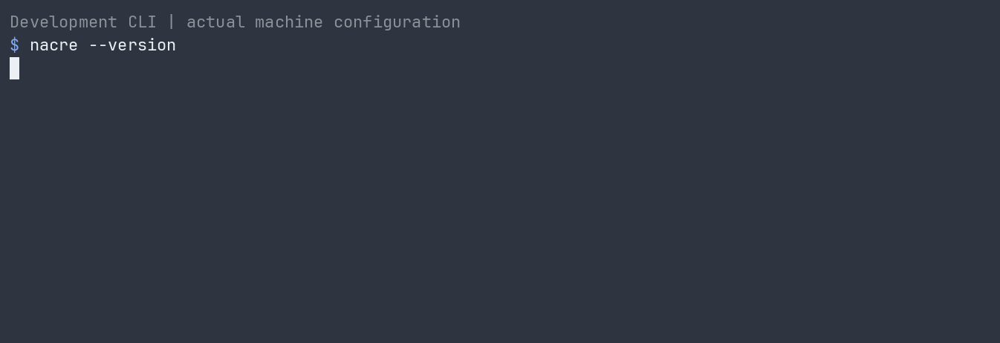

# Nacre

Declarative configuration and deployment for existing Arch Linux and Hyprland machines, evaluated with Nix.

[](https://github.com/abnertu/nacre/actions/workflows/validate-deployment.yml?query=branch%3Amain)
[](https://github.com/abnertu/nacre/releases/latest)
[](https://archlinux.org/)

[Nix](https://nixos.org/) validates typed policy and builds a fixed deployment with its [Home Manager](https://github.com/nix-community/home-manager) generation. Arch adapters converge native state before that exact home activates. Keep machine policy in a separate flake that follows Nacre. Credentials and mutable application data stay outside Git and the Nix store.





Recorded from the current machine. Personal identifiers are redacted; timing is edited for readability.
See the [recording sources](docs/assets/demo/README.md).

## Install

Start from Arch Linux `x86_64` with network access and an existing login account in `wheel`. Nacre does not install the base operating system.

Read [the install script](scripts/install.sh). Then run:

```bash
bash <(curl -fsSL https://github.com/abnertu/nacre/releases/latest/download/install.sh)
```

The script installs missing prerequisites, including Nix and yay. Then it runs the newest release of `nacre`:

- Without a checkout, `nacre install` creates a machine flake at `~/.config/nacre`. It shows a preview of the changes and asks before it deploys.
- With `NACRE_REPO` set, `nacre install --repo` clones that machine repository instead.
- With a checkout, `nacre upgrade self` adopts the newest Nacre.

Run the same command again to upgrade. See [installation](docs/install.md) for unattended setup and restores.

## Usage

```bash
nacre plan            # preview changes
nacre switch          # converge Arch and activate the built home
nacre upgrade system  # also upgrade declared pacman and AUR packages
nacre upgrade self    # adopt the newest Nacre, plan, then switch
nacre checkhealth     # report drift and pending work
```

A routine `switch` installs no packages. `nacre upgrade self` follows the channel of the machine flake's `nacre` input:

- `github:abnertu/nacre/vX.Y.Z` moves to the newest release tag.
- `github:abnertu/nacre` follows `main`.

It prints the old and the new revision, shows the plan and asks before `switch`. Then review and commit `flake.nix` and `flake.lock`.

## Configuration

The machine's `configuration.nix` selects a `minimal`, `runner` or `workstation` role and overrides its baseline:

```nix
role = "workstation";
networking.firewall.enable = false;
users.users.alice.home.programs.git.settings.init.defaultBranch = "main";
```

The workstation role adds Hyprland through UWSM, Noctalia and shared desktop configuration. Optional features include local AI, virtualization, a NetworkManager hotspot and machine-owned adapters. The [fixture machine](checks/fixtures/configuration.nix) demonstrates the full configuration.

The [Runner role](docs/gitlab-runner.md#runner-role) enables rootless GitLab Runner instances and Podman without desktop or KVM tools.

## Ownership

The machine flake supplies identity, existing login accounts, hardware, optional features and personal home modules. Nacre supplies fixed outputs, including `#deployment`, `#nacre` and `lib.configuration`.

| Task | Owner |
| --- | --- |
| Typed policy and build artifacts | Nix and Nacre modules |
| Native files, packages, accounts and services | Arch adapters using [nix-adapter](https://github.com/abnertu/nix-adapter) |
| User configuration and services | Home Manager |
| Hyprland startup | UWSM |
| Hyprland and Neovim sources | Pinned [Hyprland](https://github.com/abnertu/hypr) and [Neovim](https://github.com/abnertu/orbit.nvim) inputs, or machine-selected sources |
| Credentials, mutable data and feature preparation | Operator |

| Guide | Use it for |
| --- | --- |
| [Install](docs/install.md) | Bootstrap and create a machine flake |
| [Configuration](docs/configuration.md) | Roles, options, users and extensions |
| [Deployment](docs/deployment.md) | Commands, diagnostics, migration and recovery |
| [System settings](docs/system-settings.md) | Native ownership and pending changes |
| [Desktop session](docs/desktop-session.md) | Startup, themes and local development |
| [Noctalia](docs/noctalia-config.md) | Review, capture and deploy UI preferences |
| [Hotspot](docs/hotspot.md) | Adopt an existing AP connection |
| [Local AI](docs/ai.md) | Prepare models and serve loopback APIs |
| [GitLab Runner](docs/gitlab-runner.md) | Declare Runner instances and manage their deployment boundary |
| [Backup](docs/backup.md) | Preserve state outside the flake |

[CONTEXT.md](CONTEXT.md) explains composition. [CHANGELOG.md](CHANGELOG.md) records releases.
